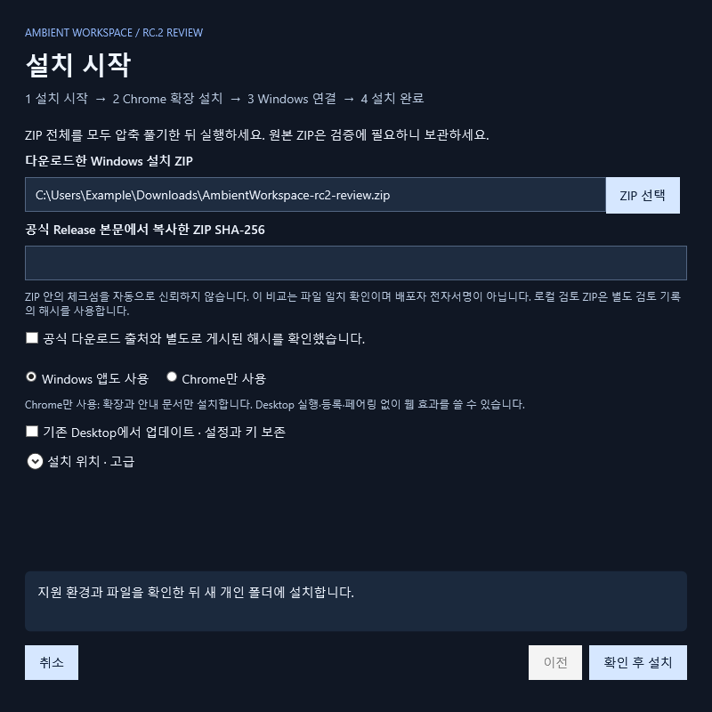
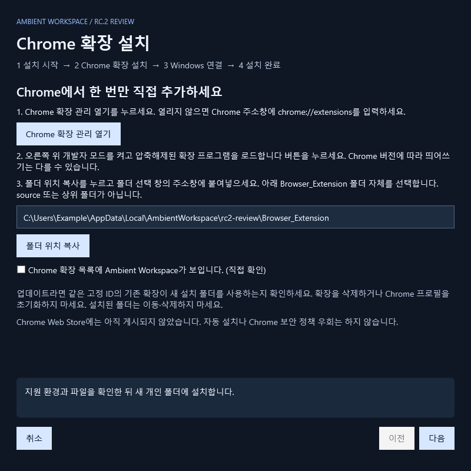
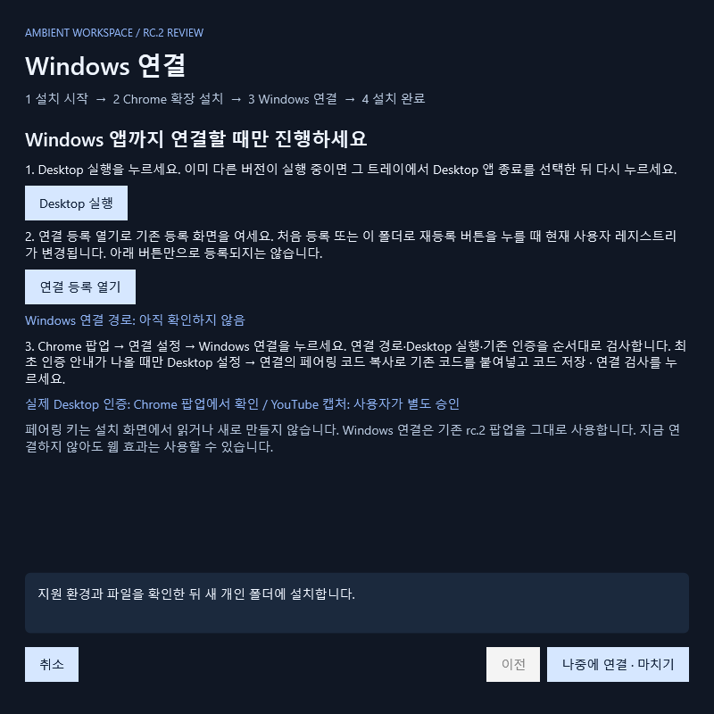
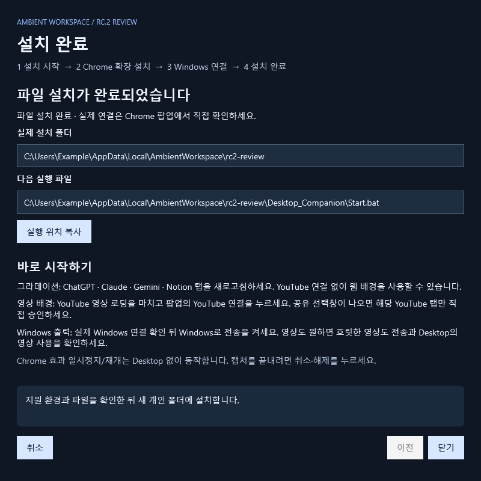

# 처음 시작하기 — rc.2 공개 검토판

이 안내는 **새 마법사가 들어 있는 rc.2 ZIP**의 화면을 기준으로 합니다. 공개 rc.1은 [기존 수동 설치 안내](WINDOWS_PORTABLE_GUIDE.md)를 사용하세요. 아래 이미지는 현재 설치 코드의 실제 WPF UI를 **합성 경로로 렌더링**한 것으로, 실제 Chrome 설치·인증 성공 증거가 아닙니다.

## 준비: 어떤 파일을 받나요?

[**Windows 설치 ZIP 바로 다운로드**](https://github.com/Yu-HsH/ambient-workspace/releases/download/v1.0.0-rc.2-review.1/AmbientWorkspace-1.0.0-rc.2-review.1-windows.zip)를 누르세요. **`AmbientWorkspace-1.0.0-rc.2-review.1-windows.zip` 한 개**를 받으면 됩니다. `Source code (zip)`을 받지 마세요. 이 버전은 실제 환경 검증을 위한 공개 Pre-release이며 정식판이 아닙니다. 이전 rc.1은 새 마법사가 없는 수동 설치판입니다.

[이 버전의 설치 확인값(SHA-256)](https://github.com/Yu-HsH/ambient-workspace/releases/tag/v1.0.0-rc.2-review.1)을 복사할 수 있도록 페이지를 열어 두세요. 같은 ZIP 안의 manifest나 동봉 체크섬은 다운로드 출처나 배포자 서명을 인증하지 않습니다. 출처를 확인하지 못했거나 Windows가 실행을 차단하면 [문제 해결](TROUBLESHOOTING.md)을 먼저 읽습니다. 보안 설정 변경·관리자 실행·차단 해제 명령을 설치 단계로 요구하지 않습니다.

ZIP을 오른쪽 클릭 → **모두 압축 풀기** → 풀린 폴더의 **`Install.bat`**을 두 번 클릭합니다. **원본 ZIP도 보관**하세요. ZIP 안에서 파일 하나만 실행하면 설치할 수 없습니다.

## 1. 설치 시작



원본 ZIP 위치는 가능한 경우 자동으로 채웁니다. 비어 있으면 **ZIP 선택**을 누르세요. 공식 Release 본문에서 별도로 확인한 **64자리 SHA-256**을 넣고 출처 확인란을 선택합니다. 로컬 검토본은 별도 검토 기록의 해시를 사용합니다.

- **Windows 앱도 사용**: Chrome과 Windows 앱의 조명을 함께 사용합니다.
- **Chrome만 사용**: 확장과 문서만 설치합니다. Desktop 파일·Native 등록·페어링은 필요하지 않습니다.

**확인 후 설치**를 누르면 지원 환경·무결성·개인 폴더 권한을 검사합니다. 기본 관리 위치는 `%LOCALAPPDATA%\AmbientWorkspace`, 실제 제품은 그 안의 **새 버전별 폴더**에 설치됩니다. 막히면 **설치 위치 · 고급**에서 기존 제품과 겹치지 않는 새 개인 위치를 선택합니다. 기존 폴더의 권한을 자동으로 바꾸지 않습니다.

## 2. Chrome 확장 설치



1. **Chrome 확장 관리 열기**를 누릅니다. 안 열리면 Chrome 주소창에 아래 주소를 직접 입력합니다.
2. 오른쪽 위 **개발자 모드**를 켭니다.
3. **압축해제된 확장 프로그램을 로드합니다**를 누릅니다. Chrome 버전·언어에 따라 띄어쓰기나 번역은 다를 수 있습니다.
4. 마법사의 **폴더 위치 복사** → 폴더 선택 창의 주소창에 붙여넣고 이동 → **`Browser_Extension` 폴더 자체**를 선택합니다. `manifest.json`이 바로 들어 있는 폴더입니다. `source`, ZIP 원본, 상위 버전 폴더를 선택하지 마세요.

```text
chrome://extensions
```

확장 목록에 **Ambient Workspace**가 보이는지 직접 확인하고 마법사의 확인란을 선택한 뒤 **다음**을 누릅니다. 확장 메뉴의 퍼즐 아이콘에서 Ambient Workspace를 고정하면 다음에 쉽게 열 수 있습니다. 제품이 Chrome 프로필을 편집하거나 확장을 몰래 설치하지 않습니다. [Chrome 공식 수동 추가 절차](https://developer.chrome.com/docs/extensions/get-started/tutorial/hello-world#load-unpacked)를 따릅니다.

**Chrome만 사용**은 3단계를 건너뛰고 완료 화면으로 갑니다. 설치된 확장 폴더는 이동하거나 삭제하지 마세요.

## 3. Windows 연결 — Windows 앱도 사용할 때만



**Desktop 실행** → 트레이의 Ambient Workspace 아이콘 확인 → **연결 등록 열기** 순서로 진행합니다. 기존 rc.2의 **Chrome 연결 등록** 창을 그대로 사용합니다.

등록 창에는 검증한 고정 공개 ID가 자동으로 채워집니다. Chrome 확장 목록의 ID와 비교한 뒤 **처음 등록**을 누릅니다. 업데이트로 다른 위치가 등록돼 있으면 **이 폴더로 재등록**을 직접 선택합니다. **이 버튼을 누를 때 현재 사용자 레지스트리를 변경합니다.** 이전 등록의 충돌·실패 복구 기능은 그대로 유지합니다.

Chrome 팝업 → **연결 설정 → Windows 연결**을 누릅니다. 연결 경로 → Desktop 실행 → 기존 인증을 확인합니다. **최초 인증** 안내가 나올 때만 Desktop 설정 → **연결 → 페어링 코드 복사** → 팝업의 **최초 인증 · 기존 코드 확인**에 붙여넣기 → **코드 저장 · 연결 검사**를 누릅니다. 키는 문의에 첨부하거나 공유하지 않습니다.

저장된 코드가 유효하면 다시 입력하지 않습니다. **등록 완료 / 실제 Desktop 인증 / YouTube 캡처는 별개**입니다. 마법사는 등록 상태만 확인하며 실제 인증과 캡처는 Chrome에서 확인합니다. 나중에 연결하려면 **나중에 연결 · 마치기**를 누르세요. 웹 효과는 먼저 쓸 수 있습니다.

## 4. 설치 완료 — 효과 시작



완료 화면의 **실제 설치 폴더**와 **다음에 Desktop을 실행할 파일**을 확인하세요. Windows 앱은 그 위치의 `Desktop_Companion\Start.bat`으로 다시 실행합니다. **실행 위치 복사**로 정확한 경로를 보관할 수 있습니다. Chrome-only는 대신 확장 폴더를 표시합니다.

- **바로 그라데이션**: ChatGPT·Claude·Gemini·Notion 탭을 새로고침합니다. 팝업의 **웹 배경 사용**이 켜져 있는지 확인합니다.
- **YouTube 영상 배경**: YouTube 페이지·영상 로딩을 마친 뒤 **YouTube 연결**. 공유 선택창이 나오면 해당 YouTube 탭만 직접 선택합니다.
- **Windows 출력**: 실제 Windows 연결 성공 뒤 **Windows로 전송**을 켭니다. 영상도 쓰려면 **흐릿한 영상도 전송**과 Desktop의 영상 사용을 확인합니다.
- **멈추기**: **Chrome 효과 일시정지/재개**와 **Windows 효과 일시정지/재개**는 별도입니다. 캡처 연결까지 끝내려면 **취소·해제**를 누릅니다.

마법사의 파일 설치 완료는 Chrome 실제 동작이나 Windows 인증·영상 출력 성공을 대신하지 않습니다.

## 기존 사용자 업데이트

1. 기존 Desktop 트레이에서 **Desktop 앱 종료**. 설정창 닫기는 종료가 아닙니다. 기존 폴더와 비공개 백업을 보존합니다.
2. 새 ZIP 전체 압축 해제 → `Install.bat`. **기존 Desktop에서 업데이트 · 설정과 키 보존** → **기존 폴더 선택** → 세 개인 파일 읽기·복사를 별도로 승인합니다. `settings.json`, 존재하는 `settings.json.bak`, `bridge-pairing.txt`만 복사하며 원본 바이트를 보존합니다. 기존 폴더에 덮어쓰지 않습니다.
3. **Chrome 확장 설치**에서 새 `Browser_Extension` 경로를 사용합니다. 기존 확장과 고정 ID가 같은지 확인하세요. 확장을 삭제하면 설정이 사라질 수 있으므로 제거·프로필 초기화로 해결하지 마세요. 옛 고정 ID 이전 버전은 [이전 확장 설정 준비](NATIVE_MESSAGING_GUIDE.md) 절차를 사용합니다.
4. 새 Desktop 실행 → **이 폴더로 재등록** → Chrome **Windows 연결**. 기존 포트는 새 연결에서 교체하고 기존 키로 인증합니다. 실패할 때만 안내에 따라 확장을 새로고침합니다.

Chrome-only 설치에는 Desktop 설정·키 이전이 없습니다. 같은 Chrome 프로필·고정 확장 ID의 저장소는 유지하지만 새 경로에서의 실제 업데이트는 별도 실기 검증 대상입니다.

## 취소·오류 뒤 이어 하기

설치 전 **취소**는 제품 파일을 만들지 않습니다. 파일 검사·복사 중에는 완료 또는 오류가 표시될 때까지 기다린 뒤 닫습니다. 중간 강제 종료·디스크 오류로 남은 `.pending-…` 또는 완료 표시 없는 폴더는 실행하지 않습니다. 개인 파일 복사본이 있을 수 있어 공유하면 안 됩니다. 자동 삭제하지 않으며 재시도는 별도의 새 폴더에 설치합니다.

**파일 설치가 끝난 뒤 닫았다면 다시 설치할 필요가 없습니다.** 표시된 설치 폴더의 `docs\GETTING_STARTED.md`를 따라 Chrome 확장을 추가합니다. Windows는 `Desktop_Companion\Start.bat`, 등록 창은 `Desktop_Companion\Setup-Chrome.bat`으로 이어 갑니다. 기존 `Install.bat`은 새 설치를 시작하는 진입점입니다.

오류 원인은 화면의 **원인 코드**와 [문제 해결](TROUBLESHOOTING.md)을 비교하세요. 키·전체 설정·원문 로그는 공유하지 않습니다.
